# AIGIS

**When maps tell a story.**

AIGIS turns unstructured material into animated time-series maps. Drop in reports, spreadsheets, photos, scans or news. Agents built on Meta's Muse models pull out every event that has a place and a time, geocode it, look for patterns and anomalies, and hand back a map you can scrub through time and interrogate in plain language.

Live at [aigis.studio](https://aigis.studio). Built for the Meta Global AI Developer Hackathon, November 2026.



## What it does

1. **Ingest.** Upload PDFs, Word files, Markdown, text, HTML, CSV, XLSX or photos. Text is chunked and read by Muse Spark, which returns structured events (what, where, when, category, value, confidence, source quote). Spreadsheets are mapped column to field once, then converted row by row. Photos take place and time from EXIF; Muse Spark's vision writes the caption and recognises the landmark. Places without coordinates are geocoded against OpenStreetMap, with Muse Spark as the gazetteer of last resort.
2. **Analyse.** A deterministic pattern engine scores temporal bursts, spatial hotspots, value outliers, lead/lag correlations between categories, and gaps. The findings are stored with the dataset and become evidence for the agent.
3. **Watch.** The map animates through time with a scrubbable timeline, playback speeds, clustering, spiderfied coincident points, an ordered trail with direction arrows, and a detail panel with media. Markers, colour and the basemap look are the creator's choices and are saved with the story.
4. **Explore.** Ask questions in the panel. The agent cites places, dates and counts, queries the dataset through tools, and moves the map itself (filter, highlight, fly, play) so the answer is shown, not just described.
5. **Design.** Describe a basemap look in a sentence. Muse Spark designs the complete style (colours, relief, road treatment, labels, halftone, grain) and Muse Image paints a seamless surface texture when the look calls for one. Watercolour, photocopy, pixel world, impasto: each becomes a reusable look.

Every saved map is a **story**. Studio creates and edits; View is read-only for sharing.

## Demos

Four pre-built stories ship with the app and open instantly:

| Story | Sources |
| --- | --- |
| A Family Summer in Europe | A camera roll, nothing else |
| Settlement of the American West | Historical chronicle + towns table |
| The Renaissance, City by City | Catalogue of works + essay |
| Voltic: A Decade of Sports Sponsorships | Business ledger + strategy memo |

## How AIGIS uses Muse

AIGIS is built on the Meta Model API. Every judgement call in the product is a Muse call. The deterministic parts (geocoding, statistics, map rendering) exist to give Muse good evidence and to render what it returns. Model IDs are gateway strings and can be overridden by environment variable (see `src/lib/ai/models.ts`). [MUSE.md](MUSE.md) has every call site, prompt and schema.

| Use case | Model | Where |
| --- | --- | --- |
| Extraction | Muse Spark 1.3 | `src/lib/ingest/extract.ts` |
| Vision | Muse Spark 1.3 | `src/lib/ingest/photos.ts`, `extract.ts` |
| Map generation | Muse Spark 1.3 | `src/lib/map/design.ts`, `styles.ts` |
| Image generation | Muse Image 1.0 | `src/lib/map/design.ts` |
| Exploration agent | Muse Spark 1.3 | `src/app/api/chat/route.ts` |

### Extraction

Prose becomes a table of events. Muse Spark reads each document chunk (about 7,000 characters, four chunks in flight) under a system prompt that casts it as a geospatial analyst and returns a structured list: one event per distinct what, where and when, the most specific place with its disambiguating parents, ISO dates with first-of-period rules when only a month or year is known, a lowercase category reused across the document, a value and unit when the event has a magnitude, a verbatim source quote, and a confidence score. Coordinates are returned only when the model is certain, otherwise the geocoder fills them in. Output is validated against a zod schema before anything is stored; nothing the model says reaches the map unchecked.

Place names the OpenStreetMap geocoders cannot resolve, or all of them when those services are down, go to Muse Spark in batches of 40 and come back as coordinates with a confidence score.

Spreadsheets are handled with one call per file. Muse Spark sees the headers and eight sample rows and returns a column mapping (time, place columns most specific first, latitude and longitude, title, category, value, unit, date format). The rows are then converted without the model, so a 10,000 row ledger costs one call. The Eras Tour demo is 149 rows mapped this way plus 32 events extracted from six kilobytes of tour notes.

### Vision

Photos, scans, charts and screenshots are read, not OCR'd. A phone photo becomes one event: EXIF supplies the position and capture time, and Muse Spark's vision receives a 1,024 pixel copy and returns an album-style title, a description for someone who cannot see the picture, a place guess with type, a category, visible entities and a confidence score. With a GPS fix the model's place guess is only used to name the location; without one it positions the event. The family vacation demo is eighty such photos with no other metadata.

Scanned documents, charts and maps go through the extraction schema as a file part in a multimodal message, with the prompt pointing the model at signage, captions, axis labels and legends. A photographed timetable yields dated events the same way a PDF does.

### Map generation

Basemap looks are designed, not picked from a list. A one-line brief ("Stamen watercolour", "1970s airline poster", "Minecraft overworld") goes to Muse Spark with a system prompt that explains how every field of the style renders on OpenStreetMap vector data and what a basemap must obey so event markers stay the subject. It returns the full design: land, water, forest, park, building, road, rail, boundary and label colours; hillshade and its opacity; landcover and road opacity; label density, transform and spacing; edge bleed; sketch or solid lines; cased, single or hidden roads; buildings on or off; halftone screen; film grain; relief saturation; and a texture brief for Muse Image. A parametric style generator turns that into a MapLibre style, so a look designed in ten seconds renders at every zoom like a built-in. Looks are saved and reusable across stories.

### Image generation

Muse Image paints the surface of a look. Paper tooth, photocopy toner, canvas weave, pixel grid: whatever the designer asked for, prefixed with instructions for a flat, evenly lit, featureless, fine-grained surface. Muse Image returns 1,600 pixel renderings, so two are requested, tone-matched, each used twice with a half-turn rotation, and feathered together on a torus into one seamless 2,560 pixel tile. The tile is laid over the map in screen space with the blend mode the designer chose, and repaint is one click when a result is not right.

### Exploration agent

The Explore tab is a conversation with the dataset. Muse Spark streams answers with a system prompt carrying the dataset summary, the top precomputed findings from the pattern engine and, for datasets of 400 events or fewer, every event as one compact line. It has four tools: `focusMap` runs in the browser and filters, highlights, flies and plays the map; `queryEvents`, `getEvent` and `getInsights` run on the server. The prompt tells it to show the answer on the map before describing it, to cite places, dates and counts, and to present cause and effect only as a hypothesis backed by timing and location. Up to six tool steps per answer.

Muse calls are routed through the Vercel AI Gateway to Meta's own endpoint (provider `meta`, zero data retention). No other model provider is used.

## Hackathon

Entry for the [Meta Global AI Developer Hackathon](https://dev.meta.ai/events/global-hackathon), submissions due November 4, 2026, 9:00 PM ET.

**Problem.** Most of what people know about where and when things happened is trapped in prose, spreadsheets and camera rolls. Turning that into a map that moves takes a GIS analyst and days of cleanup.

**Users.** Anyone with a pile of dated, located material: journalists, researchers, students, analysts, travellers, brand and operations teams.

**How Meta's models are used.** Muse Spark 1.3 for extraction, vision, structured design and the tool-calling agent; Muse Image 1.0 for generated map textures. Detailed above and in [MUSE.md](MUSE.md).

**Next.** Multi-user accounts, SAM-based region extraction from maps and charts, Muse Wonder for long multi-document investigations, exports (video, embeds), and shared editing.

## Stack

Next.js 16 (App Router, Turbopack), React 19, TypeScript, Tailwind v4, Vercel AI SDK 7, MapLibre GL with OpenFreeMap vector tiles, sharp for image work, Vercel Blob for storage in production and the local filesystem in development.

## Running locally

```bash
pnpm install
vercel link && vercel env pull   # AI Gateway auth via OIDC
pnpm dev                         # http://localhost:3003
```

Optional environment variables:

| Variable | Purpose |
| --- | --- |
| `AI_GATEWAY_API_KEY` | Gateway auth outside Vercel (instead of OIDC) |
| `AIGIS_EXTRACT_MODEL`, `AIGIS_CHAT_MODEL`, `AIGIS_IMAGE_MODEL` | Override model IDs |
| `BLOB_READ_WRITE_TOKEN` | Store datasets, media and looks in Vercel Blob; omitted, `.data/` is used |

`pnpm build` and `pnpm lint` run the production build and ESLint.

## Layout

```
src/app            routes: landing, /studio, /studio/[id], /view/[id], /api/*
src/components     Explorer, MapView, Timeline, ChatPanel, DesignPanel, SourcesPanel, HeroGlobe
src/lib/ingest     parsing, chunking, extraction, photos, pipeline
src/lib/ai         model IDs, shared tool schemas
src/lib/analysis   pattern engine
src/lib/map        style generator, look designer, texture painter
src/lib/geo        geocoding
public/samples     bundled demo datasets and media
```

Map data © OpenStreetMap contributors, tiles by OpenFreeMap.
