# AIGIS

**Maps that think.**

AIGIS is a geographic intelligence system. Drop in research reports, filings, spreadsheets, scans or news. AIGIS pulls out every fact that has a place and a time, puts it on a timeline map, and then does the analyst's work: select any window on the timeline and it counts what is inside, compares it with the window before, pulls in the outside context you have switched on, and writes a briefing on what changed, where, and what it may mean. Ask it questions and it answers from the data and the outside world, with citations, and moves the map itself.

Live at [aigis.studio](https://aigis.studio).



## What it does

1. **Ingest.** Upload PDFs, Word files, Markdown, text, HTML, CSV, XLSX or photos. Text is chunked and read by the model, which returns structured events (what, where, when, category, value, confidence, source quote). Spreadsheets are mapped column to field once, then converted row by row. Photos take place and time from EXIF; the vision model writes the caption and recognizes the landmark. Places without coordinates are geocoded against OpenStreetMap, with the model as the gazetteer of last resort.
2. **Analyze.** A deterministic pattern engine scores temporal bursts, spatial hotspots, value outliers, lead/lag correlations between categories, and gaps. The findings are stored with the dataset and become evidence for the briefings and the agent.
3. **Discover.** A discovery pass reads computed evidence for the whole story (time slices, each place's trajectory when the events carry a value, how categories diverge, what the documents state, the pattern engine's findings) and writes the five to eight findings a reader should see first: turning points, divergences, leaders and laggards, connections between what the documents claimed and what the numbers did, outliers. They open the Intelligence panel as cards; each one points the map at its evidence.
4. **Propose context.** After extraction the model proposes four to six outside sources that would explain the events: an industry index, a government series, a regulator's actions, a news beat. They are stored with the story as switches. Nothing is fetched until a user turns one on.
5. **Brief the window.** The timeline window is the unit of analysis. For whatever span is selected, AIGIS computes the counts by category and place, the value distribution, the change against the previous span of equal length and the findings that overlap it, researches each enabled context topic on the live web, and streams a briefing: headline, what the window shows, outside context with citations, what it may mean, what to ask next.
6. **Explore.** Ask questions in the panel. The agent knows what the viewer is looking at, cites places, dates and counts, queries the dataset through tools, researches outside sources when a context topic is on, and moves the map itself (filter, highlight, fly) so the answer is shown, not just described.
7. **Appearance.** Pick a basemap and marker style in Studio and save the map position viewers open on.

Every saved map is a **story**. Studio creates and edits; View is read-only for sharing.

## Demo

One pre-built story ships with the app, built entirely from public research documents:

| Story | Sources |
| --- | --- |
| U.S. Housing Markets | Freddie Mac House Price Index (185 metros, quarterly since 2019, with year-over-year change computed from the master file), Freddie Mac Multifamily Outlook 2024, Midyear 2024 and 2025, FHFA House Price Index quarterly report 2026 Q2 |

The source files are in `public/samples/housing-markets/` next to the prebuilt `dataset.json`.

## Models

Every judgment call in the product is a model call; the deterministic parts (geocoding, statistics, map rendering) give the model evidence and render what it returns. Models are reached through the Vercel AI Gateway as plain `provider/model` strings and were chosen for price. Defaults live in `src/lib/ai/models.ts` and can be overridden by environment variable.

| Role | Default | Price (per 1M tokens) | Used for |
| --- | --- | --- | --- |
| extract | `google/gemini-2.5-flash-lite` | $0.10 in / $0.40 out | Event extraction, table mapping, photo captions, geocoding fallback |
| chat | `anthropic/claude-haiku-5.5` | $0.10 in / $0.50 out | The Explore agent (streaming, tool calling) |
| research | `perplexity/sonar` | $0.25 in / $2.50 out, plus $0.001 per search | Outside context: grounded answers with citations for enabled topics |

Any gateway model with vision, structured output and tool calling works in the text roles; any search-grounded model that returns URL sources works for research.

### Extraction

Prose becomes a table of events. The model reads each document chunk (about 3,000 characters, four chunks in flight) under a system prompt that casts it as a geospatial analyst and returns a structured list: one event per distinct what, where and when, the most specific place with its disambiguating parents, ISO dates with first-of-period rules when only a month or year is known, a lowercase category reused across the document, a value and unit when the event has a magnitude, a verbatim source quote, and a confidence score. Coordinates are returned only when the model is certain, otherwise the geocoder fills them in. Output is validated against a zod schema before anything is stored; nothing the model says reaches the map unchecked.

Place names the OpenStreetMap geocoders cannot resolve, or all of them when those services are down, go to the model in batches of 40 and come back as coordinates with a confidence score.

Spreadsheets are handled with one call per file. The model sees the headers and eight sample rows and returns a column mapping (time, place columns most specific first, latitude and longitude, title, category, value, unit, date format). The rows are then converted without the model, so a 10,000 row ledger costs one call. The Eras Tour demo is 149 rows mapped this way plus 32 events extracted from six kilobytes of tour notes.

### Vision

Photos, scans, charts and screenshots are read, not OCR'd. A phone photo becomes one event: EXIF supplies the position and capture time, and the vision model receives a 1,024 pixel copy and returns an album-style title, a description for someone who cannot see the picture, a place guess with type, a category, visible entities and a confidence score. With a GPS fix the model's place guess is only used to name the location; without one it positions the event. The family vacation demo is eighty such photos with no other metadata.

Scanned documents, charts and maps go through the extraction schema as a file part in a multimodal message, with the prompt pointing the model at signage, captions, axis labels and legends. A photographed timetable yields dated events the same way a PDF does.

### Window briefings and outside context

The window statistics (`src/lib/analysis/window.ts`) are computed, not generated: events in the window and in the previous window of equal length, counts by category and place with the change, the value distribution with the highest and lowest records, entities, and the pattern-engine findings that overlap the span. The same function runs in the browser for the chips and on the server for the prompt, so the model only ever reasons over counted facts.

Context topics are proposed once per ingest (`src/lib/ai/contexts.ts`) from the dataset summary and a sample of events, and stored on the story as switches. When a briefing or a chat question runs with topics on, each topic becomes one question to the research model, scoped to the window's dates and most active places (`src/lib/ai/research.ts`). The research model searches the web and returns prose plus URL sources; the briefing model is told to connect those facts to what the map shows and to end each such bullet with citation markers, and the sources are appended as a numbered list. With no topics on, the briefing says so and stays inside the data.

### Exploration agent

The Explore tab is a conversation with the dataset. The model streams answers with a system prompt carrying the dataset summary, the top precomputed findings, the statistics of the window the viewer has selected, and, for datasets of 400 events or fewer, every event as one compact line. It has five tools: `focusMap` runs in the browser and filters, highlights and flies the map; `queryEvents`, `getEvent`, `getInsights` and, when context topics are on, `research` run on the server. The prompt tells it to show the answer on the map before describing it, to cite places, dates and counts, to research only what the data cannot answer, and to present cause and effect only as a hypothesis backed by timing and location. Up to six tool steps per answer.

## Stack

Next.js 16 (App Router, Turbopack), React 19, TypeScript, Tailwind v4, Vercel AI SDK 7, MapLibre GL with OpenFreeMap vector tiles, sharp for image work, Vercel Blob for storage in production and the local filesystem in development.

## Running locally

```bash
pnpm install
vercel link && vercel env pull   # AI Gateway auth via OIDC
pnpm dev                         # http://localhost:3003
```

Optional environment variables:

| Variable | Purpose |
| --- | --- |
| `AI_GATEWAY_API_KEY` | Gateway auth outside Vercel (instead of OIDC) |
| `AIGIS_EXTRACT_MODEL`, `AIGIS_CHAT_MODEL`, `AIGIS_RESEARCH_MODEL` | Override model IDs |
| `BLOB_READ_WRITE_TOKEN` or `BLOB_STORE_ID` | Store datasets and media in Vercel Blob (classic token or OIDC store); omitted, `.data/` is used |

`pnpm build` and `pnpm lint` run the production build and ESLint.

## Layout

```
src/app            routes: landing, /studio, /studio/[id], /view/[id], /api/*
src/components     Explorer, MapView, Timeline, ChatPanel, Briefing, DesignPanel, SourcesPanel
src/lib/ingest     parsing, chunking, extraction, photos, pipeline
src/lib/ai         model IDs, shared tool schemas, discovery pass, context proposals, web research
src/lib/analysis   pattern engine, window statistics, discovery evidence
src/lib/map        style generator
src/lib/geo        geocoding
public/samples     the bundled demo: source documents and prebuilt dataset
```

Map data © OpenStreetMap contributors, tiles by OpenFreeMap.
